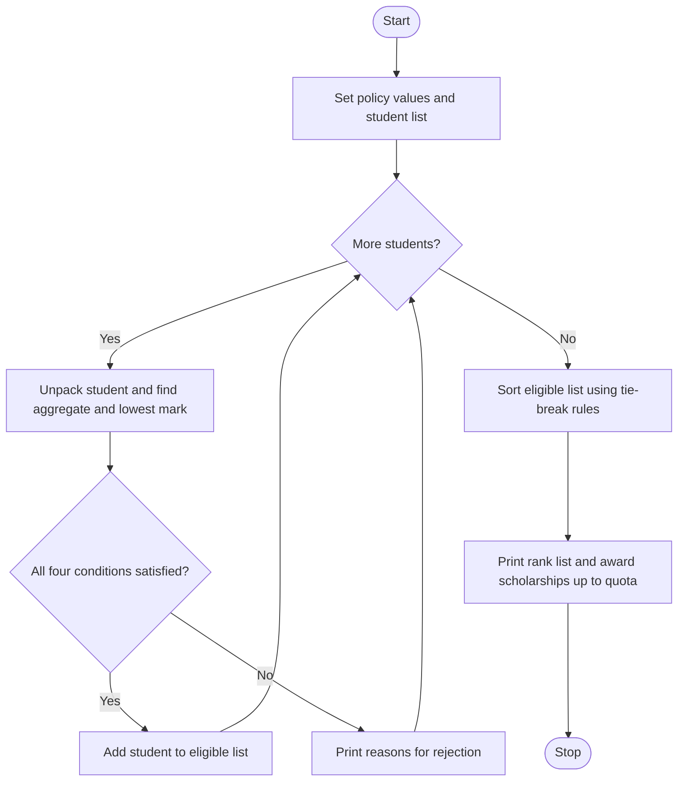

# Case Study 1: University Scholarship Allocation

## 1. Problem Statement
A university offers a limited number of merit scholarships. Each applicant is described by subject-wise marks, attendance and family income. The program must check every applicant against the scholarship rules, list the reason(s) why a student is rejected, rank the eligible students, resolve ties using fixed rules, and award scholarships up to the available quota.

## 2. Objectives
- Apply multiple conditions (aggregate, subject minimum, attendance, income) to each applicant.
- Store applicant records as tuples and process them using tuple unpacking.
- Rank students by sorting a list using nested loops (bubble sort).
- Resolve ties with predefined, deterministic rules.

## 3. Assumptions
- Aggregate = average of all subject marks (out of 100).
- Eligibility needs: aggregate >= 75, every subject >= 50, attendance >= 75 %, annual income <= Rs. 3,00,000.
- Only 3 scholarships are available (quota = 3).
- Tie-break order: higher aggregate, then higher attendance, then lower income, then name in alphabetical order.
- All input data is valid numbers (no missing values).

## 4. Algorithm
1. Store the policy values and the list of student tuples.
2. For each student, unpack name, marks, attendance and income.
3. Calculate the total, the aggregate and the lowest mark using a loop.
4. Test the four conditions; store every failed condition as a reason.
5. If there are no reasons, add the student to the `eligible` list; otherwise print the reasons.
6. Sort the `eligible` list with bubble sort, comparing tuples `(aggregate, attendance, -income)`; for exact ties compare names.
7. Print the rank list; the first QUOTA students receive the scholarship, others go to the waiting list.
8. Print a note for every tie that was resolved.

## 5. Pseudocode
```text
START
  SET MIN_AGGREGATE, MIN_SUBJECT, MIN_ATTENDANCE, MAX_INCOME, QUOTA
  READ list of students (name, marks, attendance, income)
  eligible = empty list
  FOR each student
      total = 0 ; lowest = first mark
      FOR each mark m
          total = total + m
          IF m < lowest THEN lowest = m
      aggregate = total / number of marks
      reasons = empty list
      IF aggregate < MIN_AGGREGATE THEN add reason
      IF lowest < MIN_SUBJECT THEN add reason
      IF attendance < MIN_ATTENDANCE THEN add reason
      IF income > MAX_INCOME THEN add reason
      IF reasons is empty THEN add student to eligible
      ELSE PRINT reasons
  FOR i = 0 to n-2
      FOR j = 0 to n-2-i
          IF key(j) < key(j+1) OR (keys equal AND name(j) > name(j+1))
              swap eligible[j] and eligible[j+1]
  PRINT rank list ; first QUOTA students get scholarship
STOP
```

## 6. Flowchart


## 7. Source Code
The complete, commented program is in [`scholarship_allocation.py`](scholarship_allocation.py).

To run it:
```bash
python scholarship_allocation.py
```

## 8. Test Cases
| Test | Input / Scenario | Expected Result |
|------|------------------|-----------------|
| T1 | Asha: marks 88,92,85,90, att 92, income 2,50,000 | ELIGIBLE (aggregate 88.75) |
| T2 | Bharat: marks 70,80,65,75 | NOT ELIGIBLE: aggregate below 75 |
| T3 | Deepak: marks 95,35,90,92 | NOT ELIGIBLE: a subject below 50 |
| T4 | Esha: attendance 70 | NOT ELIGIBLE: attendance below 75 |
| T5 | Farhan: income 4,50,000 | NOT ELIGIBLE: income above 300000 |
| T6 | Asha and Chitra have identical marks and attendance; incomes 2,50,000 and 2,00,000 | Chitra ranked 1, Asha ranked 2 (lower income wins) |
| T7 | Eligible students = 3, quota = 3 | All three receive SCHOLARSHIP AWARDED; tie note printed |

## 9. Output
```text
ELIGIBILITY CHECK
------------------------------------------------------------
Asha     -> ELIGIBLE (aggregate 88.75)
Bharat   -> NOT ELIGIBLE: aggregate below 75
Chitra   -> ELIGIBLE (aggregate 88.75)
Deepak   -> NOT ELIGIBLE: a subject below 50
Esha     -> NOT ELIGIBLE: attendance below 75
Farhan   -> NOT ELIGIBLE: income above 300000
Gita     -> ELIGIBLE (aggregate 80.50)

RANK LIST (quota = 3)
------------------------------------------------------------
Rank  Name      Aggregate  Attend.  Income   Result
1     Chitra    88.75      92       200000   SCHOLARSHIP AWARDED
2     Asha      88.75      92       250000   SCHOLARSHIP AWARDED
3     Gita      80.50      90       280000   SCHOLARSHIP AWARDED

Tie on aggregate between Chitra and Asha resolved using attendance/income/name rules.
```


## 10. Explanation Notes (for viva / demo)
- Tuples compare item by item, so `(aggregate, attendance, -income)` handles all tie-break rules in one comparison. The minus sign makes a *lower* income rank higher.
- Bubble sort repeatedly swaps neighbouring items that are in the wrong order.
- `name, marks, attendance, income = student` is tuple unpacking.

## 11. Conclusion
The program correctly filters applicants, explains every rejection, ranks the eligible students and resolves the Asha/Chitra tie using the income rule. It shows how tuples, lists, loops and conditions can be combined to build a fair decision system. It can be extended by reading data from the keyboard or by adding more tie-break rules.
